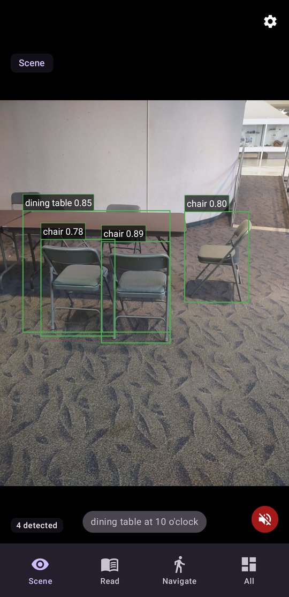
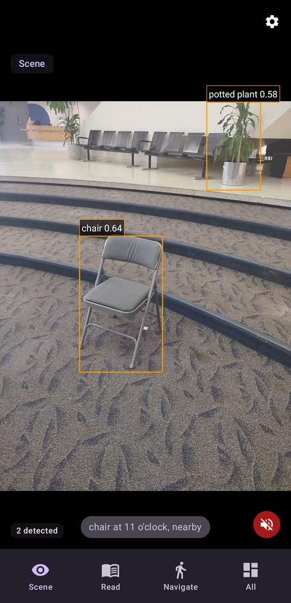
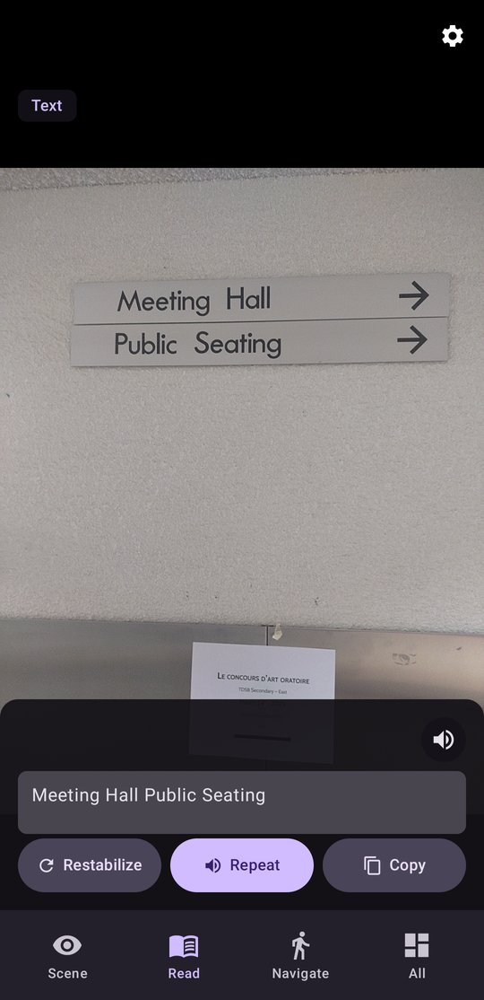
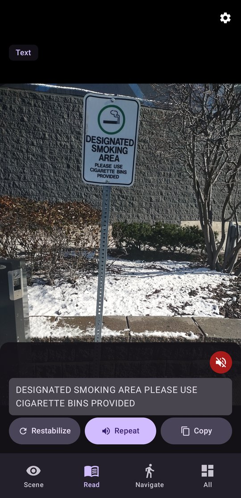
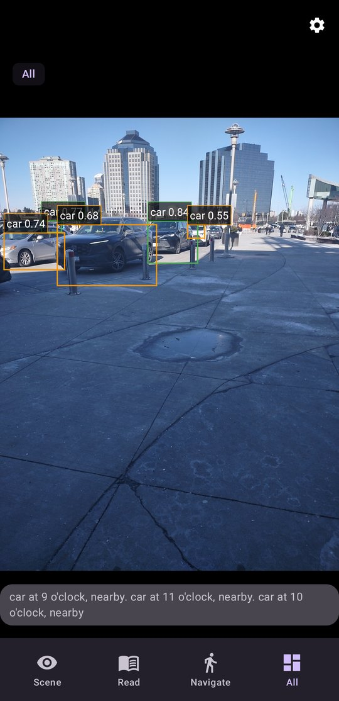
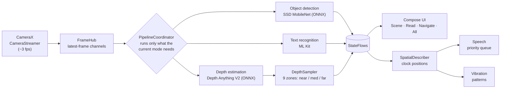

# PathSense

An Android app that helps blind and low-vision users understand their surroundings: it detects objects, reads text aloud, and warns about obstacles using only the phone's camera, with everything processed on-device.

 

## Screenshots

| Scene: objects by clock position | Scene: chair and plant | Read: wayfinding sign | Read: printed notice | All: detection outdoors |
|:---:|:---:|:---:|:---:|:---:|
|  |  |  |  |  |

## Tech Stack

Kotlin · Jetpack Compose · CameraX · ONNX Runtime (SSD MobileNet, Depth Anything V2) · Google ML Kit · Kotlin Coroutines & Flow

## Features

- **Scene mode**: detects everyday objects (80 COCO classes) and announces them by clock position and distance, e.g. *"Person at 12 o'clock, close."*
- **Read mode**: recognizes text on signs, documents, and screens and reads it aloud.
- **Navigate mode**: builds a depth map, splits the view into 9 zones, and warns about near obstacles or confirms *"Clear path ahead."*
- **All mode**: runs detection, text reading, and obstacle warnings together.
- **Built for accessibility**: prioritized speech queue that suppresses repeats, distinct vibration patterns, TalkBack labels, high-contrast and large-text modes, adjustable speech rate and pitch.
- **Fully offline**: no network calls or backend; all three models run on the phone.

## Architecture



Camera frames are published to a hub with one "keep only the latest frame" channel per pipeline, so a slow model (depth) never backs up a fast one (detection). The coordinator turns pipelines on or off per mode, and results flow back to the UI and to the accessibility layer, which turns them into spoken descriptions and haptic feedback.

## Getting Started

**Prerequisites:** Android Studio (or JDK 17+ and Android SDK 36), and an Android 8.0+ phone with a camera.

```bash
git clone https://github.com/JasonServito/pathsense.git
cd pathsense
./gradlew assembleDebug        # build the APK (Windows: gradlew.bat assembleDebug)
./gradlew testDebugUnitTest    # run unit tests
```

To run it, open the project in Android Studio and press **Run** with a phone connected, or use `./gradlew installDebug` *(not verified)*. The ONNX models are included in `app/src/main/assets/`, so no extra download is needed.

## Technical Decisions & Challenges

- **On-device ONNX models instead of a cloud API**: the app works with no connection and never uploads camera frames. Measured on a test device: object detection ~50 ms per frame, text recognition ~78 ms, depth estimation ~2.1 s.
- **Separate latest-frame channels per pipeline**: each model runs at its own pace and always processes the newest frame instead of a growing backlog.
- **Depth model stability**: the depth model caused native crashes on some devices. Depth is now enabled only after the model loads successfully, and if inference fails it is switched off at runtime while detection and text reading keep working.
- **Letterboxed input for detection**: frames are padded instead of stretched to 300×300, so the boxes map back onto the camera preview accurately.

## Next Steps

- Run depth on the GPU/NNAPI or use a quantized model to bring depth latency well under a second.
- Smooth detections across frames so announcements are steadier.
- Download models on first launch to cut the APK size.
- Add instrumented UI tests to CI and publish a release APK.
- Add more languages for speech and text recognition.

## Credits

Built as a team project (4 members).

Models: [Depth Anything V2 Small](https://github.com/DepthAnything/Depth-Anything-V2) (Apache-2.0) and [SSD MobileNet v1](https://github.com/onnx/models) from the ONNX Model Zoo.

## License

[MIT](LICENSE)
